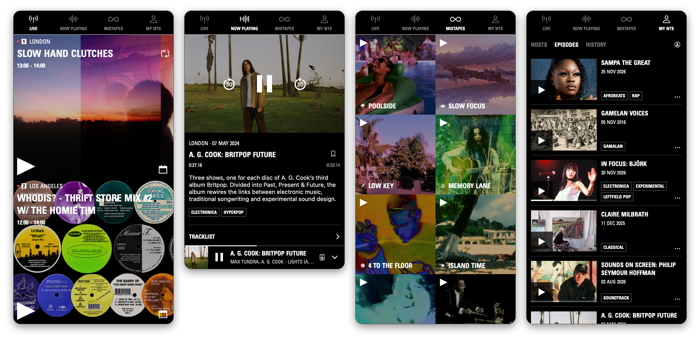

# NTSBAR

An unofficial macOS menu bar player for [NTS Radio](https://www.nts.live). Requires macOS 26 or later.

## Features

- **Lightweight menubar app.** No browser tab to keep open. Media keys and Control Centre work, and playback recovers on its own after sleep or a network drop.
- **Direct Sonos connection.** Live channels, Infinite Mixtapes and archive episodes play straight on a Sonos room, with seeking and group volume. AirPlay works too.
- **Episode progress tracking.** Sign in with your NTS account and episodes resume from wherever you stopped, whether that was on nts.live, your iPhone or this Mac.
- **Live tracklists.** Click a track to jump to it in an archive episode.
- **Persistent mini player.** Sits under every page with play/pause, times and a seek bar. Hover it to see the track playing now, and click it to open Now Playing.
- **Check schedule.** Two weeks of both channels, plus a single view of when the shows you follow are on.

Not affiliated with NTS. It uses the same public endpoints as nts.live.